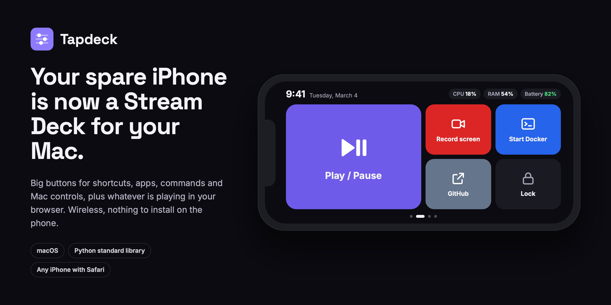
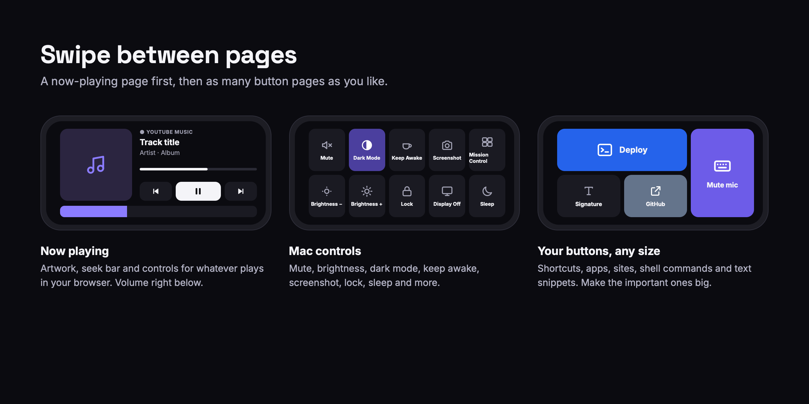
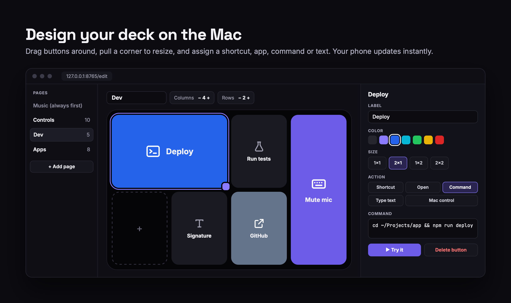
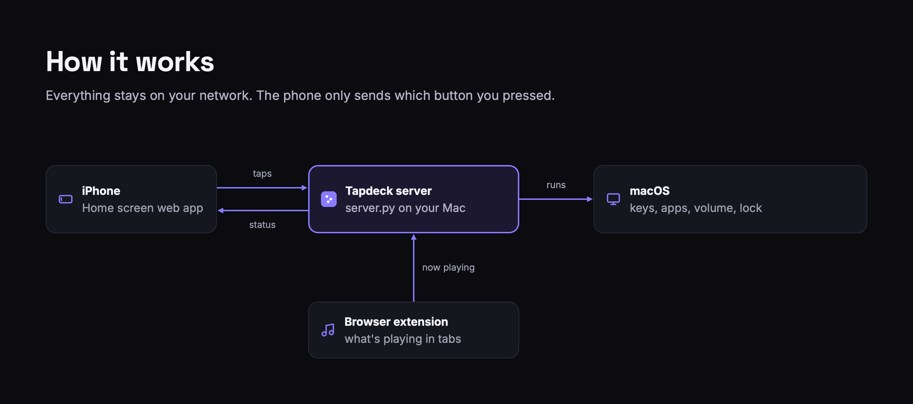

# Tapdeck



Turn a spare iPhone into a wireless Stream Deck for your Mac.

Put an old phone on a stand next to your keyboard and get big, assignable buttons for anything you do often: keyboard shortcuts, apps, websites, shell commands, text snippets and Mac controls. A music page shows what's playing in your browser with artwork, a seek bar and playback controls.

- **Assignable buttons**: pages of big buttons, designed in an editor on your Mac. Pick each page's grid (up to 6 × 4) and make any button wide, tall or 2 × 2.
  - **Shortcut**: press any key combination, e.g. ⌘⇧5
  - **Open**: launch an app, a website or a folder
  - **Command**: run a shell command in zsh, like your terminal does
  - **Type text**: type a saved snippet wherever the cursor is
  - **Mac control**: play/pause, next, volume, brightness, mute, dark mode, keep awake, screenshot, Mission Control, lock, display off, sleep
- **Now playing**: any browser tab that plays audio or video (YouTube, YouTube Music, Spotify Web, SoundCloud…), with artwork and seeking. When nothing plays in the browser, the buttons act as your keyboard's media keys, so desktop apps work too.
- **Stats bar**: clock, CPU, RAM and battery
- **Swipeable pages**, landscape-first, English and Turkish UI



Nothing to install on the phone: it's a web app you add to the home screen. The Mac side is one Python file that uses only the standard library, and it runs only while you want it to.

## Requirements

- macOS with the built-in `python3`
- Phone and Mac on the same Wi-Fi
- A Chromium-based browser (Chrome, Arc, Brave, Edge, Opera, Vivaldi) to see what's playing in your tabs. Other browsers still work through the media keys fallback, without track info.

## Setup

**1. Start Tapdeck**

The easiest way is a Dock app. Build it once:

```sh
python3 server.py --make-app
```

Drag the new **Tapdeck.app** to your Dock.

- **Click it** to start Tapdeck.
- **Click it again** while it runs to choose **Edit Buttons**, **Connect Phone** or **Stop Tapdeck**.
- **Quit it** (⌘Q, or Quit in its Dock menu) to stop Tapdeck.

If Tapdeck is already running from somewhere else (for example Terminal), the app takes it over, so you can still stop it from the Dock.

Without the app, double-click **`Tapdeck.command`** in Finder: Tapdeck runs in a Terminal window until you close it. Or run it yourself:

```sh
python3 server.py --open   # --open also opens the button editor
```

The first time you run Tapdeck:

- macOS asks whether `python3` may accept incoming connections. Choose **Allow**.
- macOS asks for **Accessibility** access for the app running Tapdeck (Tapdeck, or Terminal). Allow it in *System Settings → Privacy & Security → Accessibility*. Shortcuts, typed text and media keys need it.
- If double-clicking `Tapdeck.command` is blocked for a file downloaded from the internet, right-click it and choose **Open** once.

**2. Connect your phone**

1. Open <http://127.0.0.1:8765/connect> on the Mac and scan the QR code with the iPhone camera.
2. In Safari, tap **Share → Add to Home Screen**. Keep **Open as Web App** on.
3. Open **Tapdeck** from the home screen and turn the phone sideways.

To keep the phone's screen on, go to *Settings → Display & Brightness → Auto-Lock → Never*. The panel also tries to keep the screen awake while it's open.

When Tapdeck isn't running, the phone shows "Can't reach your Mac" and reconnects by itself once you start Tapdeck again.

**3. Install the browser extension (optional, for now playing)**

1. Open `chrome://extensions` (in Arc: `arc://extensions`).
2. Turn on **Developer mode**.
3. Click **Load unpacked** and select the `extension` folder, or drag the folder onto the page.
4. Reload any tabs that were already open.

The extension only talks to `127.0.0.1:8765`. It runs on all sites so it can find any tab that plays audio or video.

## Editing buttons

Open **<http://127.0.0.1:8765/edit>** in a browser on your Mac while Tapdeck is running.



- Click an empty cell to add a button, or click a button to change it.
- Drag a button to move it, or drop it on another page in the sidebar. A green outline shows where it will land; red means it doesn't fit.
- Drag the round handle on a selected button's corner to resize it, or pick a size (1 × 1, 2 × 1, 1 × 2, 2 × 2, 3 × 1).
- Set each page's columns and rows above the grid. Buttons that no longer fit move to a free spot.
- <kbd>Delete</kbd> removes the selected button, <kbd>Esc</kbd> clears the selection.
- Pick a label, an emoji icon (⌃⌘Space opens the emoji picker) and a color.
- Use **▶ Try it** to run a button on the Mac without touching your phone.
- Add, rename, reorder and delete pages in the sidebar.

Changes save automatically and show up on the phone within a second.

The editor only opens on the Mac itself. Buttons can run commands, so other devices can press buttons but never create or change them.

## Files

| File | What it is |
| --- | --- |
| `Tapdeck.command` | Double-click to start Tapdeck in a Terminal window |
| `server.py` | Starts the server (`--open`, `--make-app`, `--install`, `--uninstall`) |
| `tapdeck/macapp.py`, `icon.py` | Builds Tapdeck.app for the Dock; draws the icon |
| `tapdeck/` | The server, standard library only |
| `tapdeck/handler.py` | HTTP routes, token and Mac-only checks |
| `tapdeck/panel.py` | What each button and control does |
| `tapdeck/deck.py` | Pages and buttons: validation, defaults, `deck.json` |
| `tapdeck/media.py` | Now playing from the extension, media keys as fallback |
| `tapdeck/keyboard.py` | Shortcuts, typed text and media keys |
| `tapdeck/display.py`, `system.py`, `apps.py`, `shell.py` | Brightness; CPU, memory, battery, volume; apps and icons; running commands |
| `web/index.html`, `web/js/phone.js`, `web/css/phone.css` | The phone app |
| `web/edit.html`, `web/js/editor.js`, `web/css/editor.css` | The button editor |
| `web/css/base.css`, `web/js/common.js` | Colors, the button tile, icons and labels shared by both |
| `extension/` | Browser extension for now playing |
| `config.json` | Created on first run: port and access token. Keep it private. |
| `deck.json` | Created on first run: your pages and buttons |

To change the port, edit `port` in `config.json`, and also `extension/manifest.json` and `extension/background.js`. To sign out all phones, delete `token` from `config.json` and restart.

## Start at login (optional)

If you'd rather have Tapdeck always running:

```sh
python3 server.py --install     # start at login, restart if it crashes
python3 server.py --uninstall   # back to starting it yourself
```

The log goes to `~/Library/Logs/Tapdeck.log`. macOS asks for network and Accessibility access again, this time for `python3`.

## How it works



The phone talks to the Tapdeck server over your Wi-Fi. The server runs actions with `osascript`, `pmset`, `open`, `zsh`, CoreGraphics and DisplayServices. The browser extension reports what's playing in your tabs over `localhost` and receives play/pause/seek commands through a long-poll.

Security:

- Every request from the phone must carry the access token from the QR code.
- The phone receives only each button's label, icon and color. It sends back a button id. It never sees or sends commands or texts.
- The editor and its API only answer requests from the Mac itself with a `127.0.0.1`/`localhost` Host header. This blocks other devices and DNS rebinding.
- The extension endpoints require a custom header that web pages can't send without a CORS preflight, which the server never grants.

## Notes

- **Brightness** controls the built-in display through the private DisplayServices framework. It does nothing on desktop Macs or in clamshell mode.
- **Rebuilding Tapdeck.app** gives it a new ad-hoc signature, and macOS ties Accessibility permission to the signature. Remove the old entry (`tccutil reset Accessibility com.tapdeck.launcher`) and allow Tapdeck again.
- **Lock** presses ⌃⌘Q. Without Accessibility permission it turns the display off instead.
- **Keep Awake** keeps the Mac and its display from sleeping until you turn it off or stop Tapdeck.
- **Dark Mode** asks once for permission to control System Events.
- **Screenshot** needs Screen Recording permission for the app running Tapdeck.
- **Commands** run in a login, interactive zsh (`zsh -lic`) from your home folder, so your `PATH` and aliases work. Tapdeck waits 8 seconds for a result and lets longer commands keep running.
- Some pages (like Spotify Web) keep their audio element out of the page, so seeking from the phone isn't available there.
